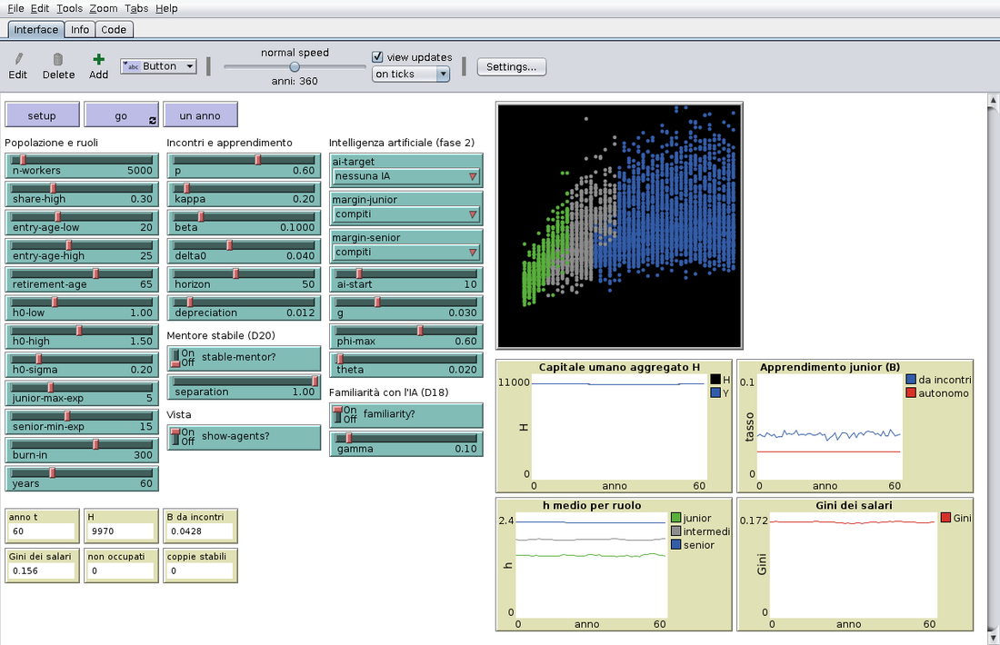

# La *skill cliff* in NetLogo

*Federico Bassi e Vincenzo Lio.* `skill_cliff.nlogo` è il modello della **prima versione dell'articolo**
(tag git `articolo-v1`, [PDF](https://viciuslio.github.io/skill-cliff-abm/articolo_v1.pdf)) scritto in NetLogo:
la fase 2 con le revisioni D16–D20 nate dalle osservazioni di Federico. Il modello di riferimento resta quello in
Python (`src/skillcliff`); questo ne è un gemello, verificato scenario per scenario (sotto).

## Scaricarlo e aprirlo

1. Serve **NetLogo 6.4** (gratuito: https://www.netlogo.org/download). NetLogo 7 apre anche i file `.nlogo`.
2. Scarica il file: [skill_cliff.nlogo](https://github.com/ViciusLio/skill-cliff-abm/raw/main/Netlogo/skill_cliff.nlogo)
   (oppure, dalla pagina del file su GitHub, il pulsante *Download raw file*).
3. Aprilo con *File → Open*. La scheda **Info** riassume regole e scenari; la scheda **Code** è commentata in italiano.

## Usarlo

- **setup**, poi **go** (oppure **un anno** per avanzare di un anno). I primi 300 anni sono di burn-in: portano il
  modello a regime e non entrano nei grafici, che partono dall'anno 0. Per andare più veloci: spegni `show-agents?`
  o sposta il cursore della velocità.
- **Vista:** un punto per lavoratore; x = età, y = capitale umano. Verde = junior, grigio = intermedio,
  blu = senior, rosso = junior non occupato.
- **Grafici:** H (e Y), apprendimento dei junior (da incontri e autonomo), h medio per ruolo, Gini dei salari.

I valori iniziali dei cursori sono quelli di `configs/base.yaml`:

| NetLogo | Python (`configs/base.yaml`) | Valore |
|---|---|---|
| `n-workers` | `population.N` | 5.000 (fase 1; la fase 2 usa 50.000) |
| `share-high`, `entry-age-low/high`, `retirement-age` | `population.*` | 0,3; 20 e 25; 65 |
| `h0-low`, `h0-high`, `h0-sigma` | `population.h0`, `h0_sigma` | 1,0; 1,5; 0,2 |
| `junior-max-exp`, `senior-min-exp` | `roles.*` | 5; 15 |
| `p`, `kappa`, `beta` | `meetings.*` | 0,6; 0,2; 0,10 |
| `delta0`, `horizon`, `depreciation` | `learning.*` | 0,04; 50; 0,012 |
| `stable-mentor?`, `separation` | `meetings.stable_mentor`, `meetings.separation` | spento; 1 |
| `ai-target` | `ai.enabled` e `ai.target` | "nessuna IA" |
| `margin-junior`, `margin-senior` | `ai.margin_junior`, `ai.margin_senior` | compiti; compiti |
| `ai-start`, `g`, `phi-max`, `theta` | `ai.*` | 10; 0,03; 0,6; 0,02 |
| `familiarity?`, `gamma` | `ai.familiarity`, `ai.gamma` | acceso; 0,1 |
| `burn-in`, `years` | `burn_in`, `T` | 300; 60 |

## Gli scenari dell'articolo

| Scenario | Impostazioni |
|---|---|
| senza IA | `ai-target` = nessuna IA |
| IA che toglie compiti ai junior (p ↓) | `ai-target` = junior, `margin-junior` = compiti |
| junior che perdono il posto (non occupati) | `ai-target` = junior, `margin-junior` = posto |
| IA che toglie compiti ai senior (β ↓) | `ai-target` = senior, `margin-senior` = compiti |
| senior che perdono il posto (κ ↓) | `ai-target` = senior, `margin-senior` = posto |
| IA complementare (β ↑) | `ai-target` = complementare |
| mentore stabile (D20) | `stable-mentor?` acceso, `separation` = 0,15, `beta` = 0,0754 |

Ognuno è già un esperimento di **BehaviorSpace** (*Tools → BehaviorSpace*): 10 repliche, seed
`20261008 + numero del run`, metriche a ogni anno. La tabella contiene anche gli anni di burn-in: per le analisi
si tengono le righe con `t > 0` (sono gli anni 0–59 del modello).

## Quanto coincide con il modello Python

`scripts/docking_netlogo.py` (`make docking-netlogo`) lancia questi esperimenti senza interfaccia e li confronta
con il modello Python: N = 5.000, 30 repliche per parte, test di differenza (Welch) ed equivalenza entro ±1% (TOST),
come per il gemello Mesa. Numeri in `report/numeri_netlogo.json`.

Tutte e 7 le simulazioni coincidono: per ogni grandezza e ogni scenario l'equivalenza entro ±1% è dimostrata
(p del TOST < 0,05) e nessuna differenza è statisticamente significativa (p del test di Welch > 0,05).
Differenza tra le medie, NetLogo rispetto a Python:

| Scenario | H a fine orizzonte | h dei senior | B da incontri | Gini dei salari | altro |
|---|---|---|---|---|---|
| senza IA | −0,10% | −0,06% | +0,12% | −0,03% | |
| junior, compiti | −0,04% | −0,05% | +0,09% | −0,25% | |
| junior, posto | +0,04% | −0,10% | +0,13% | −0,04% | non occupati −0,16% |
| senior, compiti | −0,08% | −0,03% | −0,16% | −0,10% | |
| senior, posto | −0,08% | −0,03% | −0,15% | −0,12% | |
| complementare | −0,06% | −0,01% | −0,11% | 0,00% | |
| mentore stabile | −0,10% | −0,05% | −0,20% | +0,01% | coppie stabili +0,06% |

Con 10 repliche NetLogo (quelle degli esperimenti già pronti) le medie coincidono lo stesso, ma per Gini e numero
di non occupati il test di equivalenza può non bastare: servono 30 repliche.

## Differenze dal modello Python

- **Numeri casuali.** In Python ogni scenario usa gli stessi numeri casuali dello scenario senza IA, quindi le
  differenze tra scenari si misurano replica per replica. In NetLogo si confrontano medie tra repliche.
- **Qualifica.** Gli incontri avvengono sempre dentro la stessa qualifica (in Python `same_qual: true`, l'unico caso
  usato nell'articolo).
- **Calcoli fuori dal modello.** La corsa sulle griglie di g e θ, l'automazione scelta dall'impresa (D15) e la
  calibrazione di β per il mentore stabile restano negli script Python.
- **Velocità.** Una replica (300 anni di burn-in e 60 registrati, 5.000 lavoratori) richiede circa 4–7 secondi
  senza interfaccia; con la vista accesa di più.

## Se si modifica il modello

Il file è la fonte: si modifica direttamente in NetLogo. Due avvertenze:
- **Maiuscole.** NetLogo non distingue maiuscole e minuscole: per questo il capitale umano aggregato si chiama
  `H-agg` (`H` sarebbe lo stesso nome di `h`, il capitale umano di ciascun lavoratore).
- **Allineamento con il Python.** Se cambiano le regole del modello Python, il gemello va aggiornato e il confronto
  rifatto con `make docking-netlogo`.
