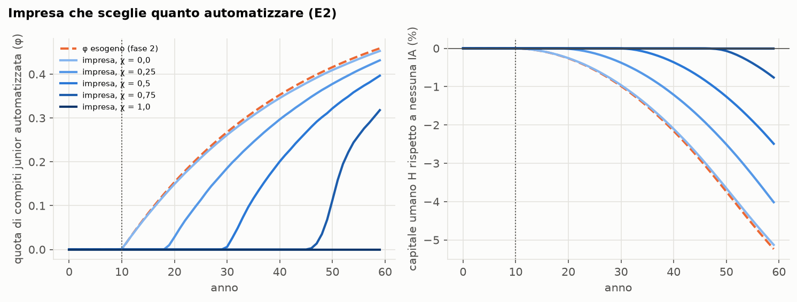
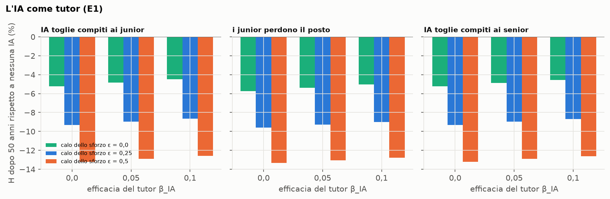

# Sintesi — versione estesa (ramo `esteso`)

*Federico Bassi e Vincenzo Lio. Meccanismi nuovi rispetto alla versione base, tutti spegnibili da configurazione:
spenti, base e scenari della fase 2 restano identici bit per bit. Piano in [piano_esteso.md](piano_esteso.md).
NetLogo: `Netlogo/skill_cliff_esteso.nlogo` (D29). N = 50.000, 30 repliche, numeri casuali comuni.*

## Decisioni

| | Decisione |
|---|---|
| D29 | NetLogo della versione estesa in un file separato, aggiornato con ogni meccanismo e verificato con il docking. |
| D30 | E2: un'impresa rappresentativa (più imprese con mobilità: passo successivo, E2b). |
| D31 | E2: l'impresa automatizza i compiti per cui l'IA costa meno del junior; retroazione dal salario dei junior. |
| D32 | E2: l'impresa internalizza una quota χ del valore formativo dei junior (base χ = 0, miope). |
| D33 | E2: confronto con il pianificatore (quota costante, come D15) e contributo equivalente sull'automazione. |
| D34 | E1: il junior impara dall'IA la parte codificabile della conoscenza dei senior di oggi. |
| D35 | E1: calo dello sforzo nell'apprendimento autonomo dei junior che usano l'IA. |
| D36 | E1: β_IA ∈ {0; 0,05; 0,10}, c = 0,5, ε ∈ {0; 0,25; 0,5}; in più c ∈ {0,75; 1} (estensione, vedi sotto). |
| D37 | Interruttori spenti di default, test, NetLogo e docking; il gemello Mesa resta alla base. |

## 1. E2 — l'impresa sceglie quanto automatizzare

Script `scripts/esteso_e2.py` (`make esteso-e2`), numeri in `report/numeri_e2.json`.

### 1.1 Equazioni come implementate (`src/skillcliff/ai.py`)

Ogni anno, guardando i junior di inizio anno (dopo gli ingressi):

$$\varphi_t = \varphi_{\max}\,\max\!\left(0,\ 1 - \frac{c_t}{w_{J,t} - \chi\, v_t}\right),\qquad c_t = \frac{c_0}{A_t},\qquad
v_t = \bar g_{t-1}\sum_{k=1}^{40}\rho^k ,$$

con $w_{J,t}$ il salario medio (= h) dei junior, $\bar g_{t-1}$ il guadagno medio dei junior dagli incontri nell'anno
precedente, ρ = 0,97. I compiti automatizzabili x ∈ [0, 1] hanno costo dell'IA $c_t/(1-x)$: si automatizzano quelli
con $x < \varphi_t/\varphi_{\max}$, e il risparmio dell'impresa è

$$S_t = J_t\,\varphi_{\max}\left[w_{J,t}\,x^* + c_t \ln(1-x^*)\right],\qquad x^* = \varphi_t/\varphi_{\max}.$$

**Calibrazione.** $c_0 = 1{,}33$: con l'impresa miope φ vale 0,149 dopo 10 anni, come il percorso esogeno (0,15).
**Valore sociale.** $W = \sum_k \rho^{k+1}(Y_t + S_t) / \sum_k \rho^{k+1} Y^{\text{senza IA}}_t - 1$ sui 50 anni dall'arrivo
dell'IA.

### 1.2 Numeri

| Impresa | φ dopo 10 / 25 / 50 anni | H dopo 50 anni | W |
|---|---|---|---|
| φ esogeno (fase 2) | 0,15 / 0,31 / 0,46 | −5,24% | — |
| miope, χ = 0 | 0,15 / 0,31 / 0,45 | −5,13% | +0,91% |
| χ = 0,25 | 0,03 / 0,25 / 0,43 | −4,02% | +1,39% |
| χ = 0,5 | 0 / 0,12 / 0,40 | −2,49% | +1,69% |
| **χ = 0,75** | 0 / 0 / 0,32 | −0,76% | **+1,73%** |
| χ = 1 | 0 / 0 / 0 | 0 | +1,64% |

*Pianificatore a quota costante: W = +1,64% con φ = 0, +1,17% con 0,1, +0,56% con 0,2, −0,26% con 0,3. Il valore
formativo di un anno da junior è in media il 67% del salario di un junior.*

1. **L'impresa miope riproduce quasi il percorso esogeno.** La retroazione c'è (junior formati peggio costano meno, e
   l'impresa automatizza un po' meno) ma è piccola: −5,13% di H contro −5,24%.
2. **L'impresa miope ottiene circa metà del valore possibile** (+0,91% contro +1,73%).
3. **L'ottimo è automatizzare più tardi, non meno per sempre.** Con χ = 0,75 l'impresa aspetta circa 35 anni e poi
   arriva a φ = 0,32. Una quota costante, che automatizza anche quando l'IA costa più dei junior, fa peggio
   (+1,64% al massimo): conta il *quando*.
4. **Contributo equivalente.** Per far scegliere all'impresa miope come quella con χ = 0,75 serve un contributo
   sull'automazione che quasi triplica il costo dell'IA: +181% in media (+198% dopo 10 anni, +95% a fine orizzonte).

### 1.3 Verifiche e limiti

- **Base identica bit per bit** con E2 spento (confronto su base e sei scenari della fase 2, N = 3.000).
- **Test:** la scelta segue la formula anno per anno (χ = 0); internalizzare riduce φ; i risparmi sono non negativi e
  nulli prima dell'IA; E2 richiede target junior e margine compiti; il pianificatore tiene φ costante.
- **Il valore formativo è grande e semplice.** È il guadagno di un anno scontato su 40 anni, senza obsolescenza e senza
  contare che il junior, da senior, insegnerà a sua volta: il primo punto lo sovrastima, il secondo lo sottostima. Il
  contributo equivalente dipende molto da questo numero.
- **Una sola impresa.** Non c'è concorrenza né mobilità: chi forma un junior non lo perde. È E2b (D30 B).

## 2. E1 — l'IA come tutor

Script `scripts/esteso_e1.py` (`make esteso-e1`), numeri in `report/numeri_e1.json`.

### 2.1 Equazioni come implementate

Dall'arrivo dell'IA, per ogni junior occupato j del gruppo di qualifica g:

$$\Delta h^{\text{IA}}_{j,t} = \beta_{IA}\, f_j\, \max\!\left(0,\ c\,\bar h^S_{g,t} - h_{j,t}\right),\qquad
\Delta h^{\text{aut}}_{j,t} = \left[\delta(s_j)\,(1-\varepsilon f_j) - d\right] h_{j,t},$$

con $f_j$ la familiarità con l'IA (D18), $\bar h^S_{g,t}$ il capitale umano medio dei senior del gruppo (l'IA ha imparato
dai senior di oggi: se si impoveriscono, si impoverisce anche il tutor), c la quota codificabile, ε il calo dello sforzo.

### 2.2 Numeri (H dopo 50 anni rispetto a nessuna IA)

| IA che toglie compiti ai junior | ε = 0 | ε = 0,25 | ε = 0,5 |
|---|---|---|---|
| nessun tutor (β_IA = 0) | −5,24% | −9,31% | −13,22% |
| β_IA = 0,05, c = 0,5 | −4,84% (compensa il 7%) | −8,95% | −12,88% |
| β_IA = 0,10, c = 0,5 | −4,50% (14%) | −8,64% | −12,59% |

**Quota codificabile** (ε = 0):

| c | β_IA = 0,05 | β_IA = 0,10 |
|---|---|---|
| 0,5 | −4,84% | −4,50% |
| 0,75 | +0,27% (compensa il 105%) | +5,26% |
| 1 | +9,48% | +23,91% |

*Junior che perdono il posto e IA che toglie compiti ai senior danno risultati molto simili (tabelle complete nel JSON).*

1. **Con c = 0,5 il tutor aiuta poco.** Il suo livello (metà del senior medio, circa 1,08) è sotto quello del junior tipico
   (circa 1,4): insegna solo ai più deboli.
2. **Il calo dello sforzo pesa più del tutor.** ε = 0,25 quasi raddoppia la perdita anche con il tutor migliore della
   griglia centrale.
3. **La soglia è la quota codificabile.** Da c ≈ 0,75 il tutor compensa tutta la perdita; con c = 1 l'IA diventa un
   secondo mentore e il capitale umano sale molto (+24%). Quanta conoscenza tacita l'IA riesca a codificare è la
   grandezza empirica decisiva.
4. **L'equivalenza p/β regge anche qui**: compiti dei junior e compiti dei senior danno numeri quasi uguali.

### 2.3 Verifiche e limiti

- **Base identica bit per bit** con E1 spento; nuova metrica B_tutor (0 senza tutor).
- **Test:** il guadagno segue la formula per i junior di un gruppo, è nullo per i non junior e prima dell'IA, aumenta H;
  il calo dello sforzo riduce l'apprendimento autonomo; parametri fuori intervallo rifiutati.
- **Estensione di D36.** La griglia confermata fissava c = 0,5; ho aggiunto c = 0,75 e 1 (senza calo dello sforzo)
  perché la risposta dipende soprattutto da c.
- **Manca la combinazione** di c alta con calo dello sforzo: quale ε annulla un tutor che sa quanto un senior?
- **Il tutor non sostituisce l'incontro tacito**: insegna una parte fissa della conoscenza dei senior, uguale per tutti.

## 3. NetLogo e docking

`Netlogo/skill_cliff_esteso.nlogo` contiene E2 ed E1 (interruttori `endogenous?` e `tutor?`, spenti di default) e
quattro esperimenti BehaviorSpace nuovi. Confronto con il Python: `scripts/docking_netlogo.py --esteso`
(`make docking-netlogo-esteso`), numeri in `report/numeri_netlogo_esteso.json`; N = 5.000, 30 repliche per parte.

| Scenario | differenza massima tra le medie | equivalenza entro ±1% |
|---|---|---|
| base (meccanismi nuovi spenti) | 0,08% | tutte le grandezze |
| E2, impresa miope | 0,27% | tutte tranne i risparmi (rumorosi: p = 0,81, intervallo ampio) |
| E2, χ = 0,5 | 0,34% | tutte tranne φ e risparmi con 30 repliche; con 60 repliche φ sì (−0,24%), risparmi p = 0,67 |
| E1, tutor | 1,26% (B dal tutor) | tutte tranne B dal tutor |
| E1, tutor e calo dello sforzo | 1,37% (B dal tutor) | tutte tranne B dal tutor |

**Un punto non spiegato.** L'apprendimento dal tutor in NetLogo è più basso dell'1,1–1,4% (con 60 repliche p = 0,04).
È una grandezza piccola (0,2% l'anno, circa 3·10⁻⁵ in valore assoluto) che dipende dalla coda dei junior più deboli;
H, h per ruolo, output e Gini coincidono entro lo 0,3% (p ≥ 0,21). Le due implementazioni, rilette, fanno le stesse
operazioni; resta da confrontare la coda della distribuzione di h dei junior nei due modelli.

Il gemello Mesa resta alla versione base (D37 A): E1 ed E2 non entrano nel docking con Mesa.

