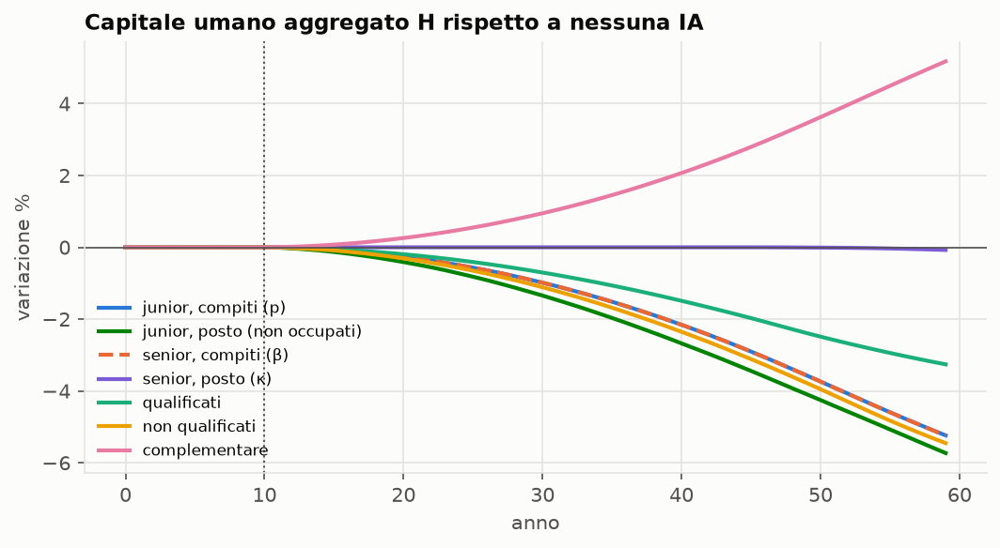
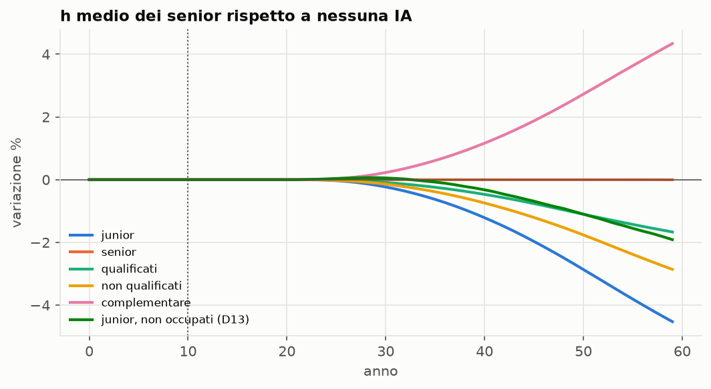
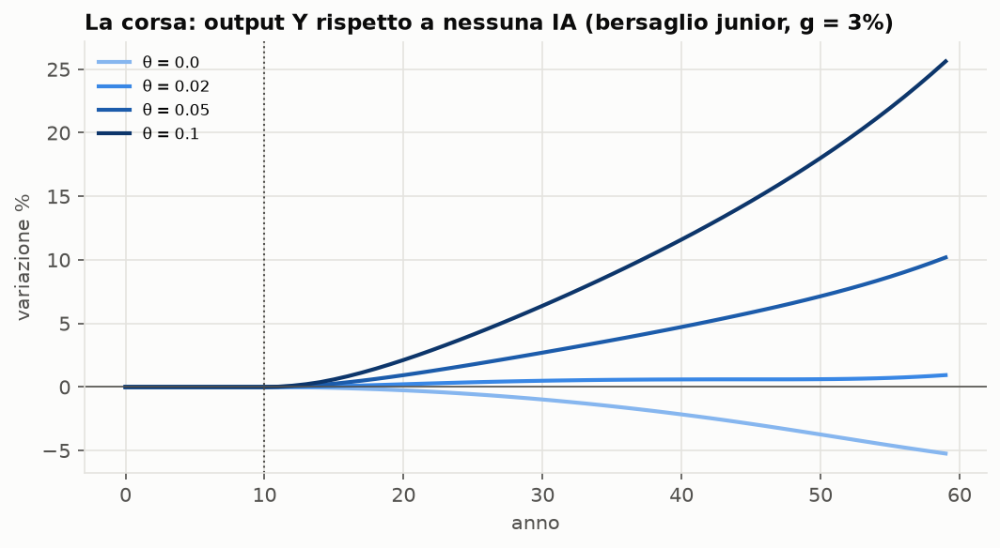
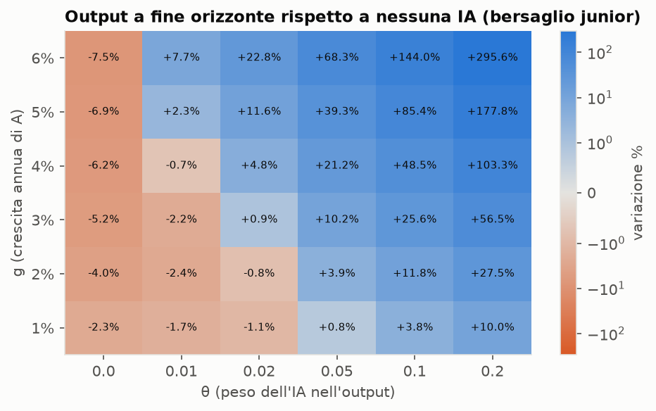
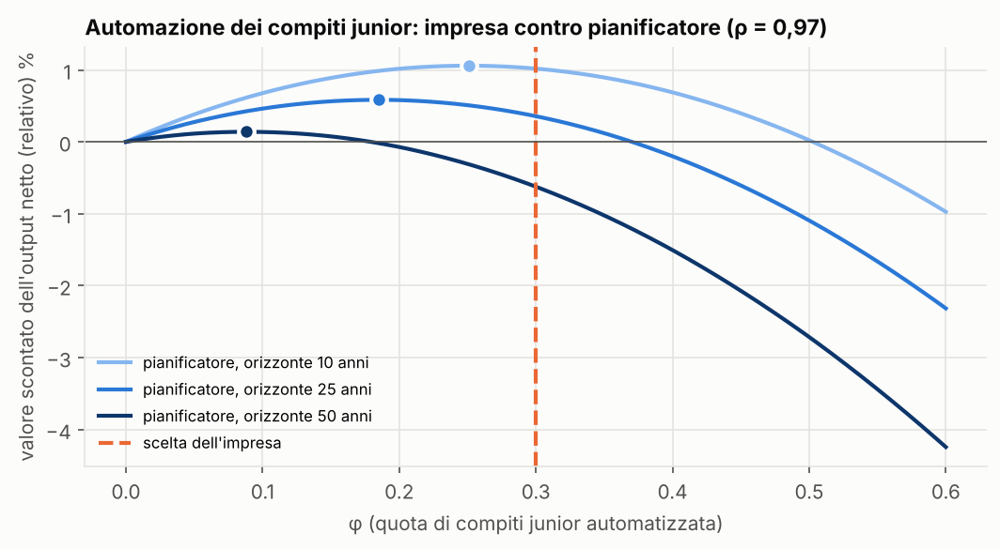
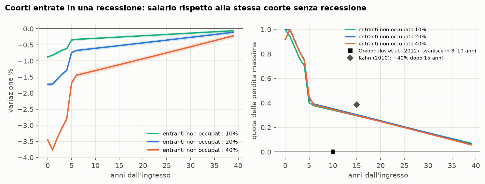

# Sintesi — Fase 2: l'intelligenza artificiale

*Federico Bassi e Vincenzo Lio. Numeri generati da `python scripts/fase2.py`
(N = 50.000, 30 repliche per scenario, seed radice 20261008) e salvati in `report/numeri_fase2.json`.
Versione interattiva: [fase 2 sul sito](https://viciuslio.github.io/skill-cliff-abm/fase2.html).*

## 1. Cosa aggiunge la fase 2

Il modello della fase 1 resta identico. L'IA arriva all'anno 10 e agisce su due canali:
- **sugli incontri:** riduce o potenzia le occasioni di apprendimento, secondo chi sostituisce;
- **sull'output:** aggiunge produttività che cresce nel tempo.

Ogni scenario usa gli stessi numeri casuali dello scenario senza IA (common random numbers):
le differenze sono dovute solo all'IA, e prima dell'anno 10 i risultati sono identici al bit (verificato dai test).

## 2. Equazioni come implementate (`src/skillcliff/ai.py`)

**Produttività dell'IA e quota di compiti automatizzati.** Con $t_0 = 10$:

$$A_t = (1+g)^{\,t-t_0}\ \text{per}\ t\ge t_0,\quad A_t = 1\ \text{prima};\qquad \varphi_t = \varphi_{\max}\left(1 - \frac{1}{A_t}\right).$$

$\varphi$ parte da zero, cresce con A e si satura a $\varphi_{\max}$. Poiché $A_{t_0} = 1$, l'IA agisce dall'anno $t_0 + 1$.

**Bersagli e margini (D16, D17).** Il bersaglio dice chi viene sostituito; il margine
(`ai.margin_junior`, `ai.margin_senior`) dice che cosa vuol dire "sostituire". Dettagli nella sez. 8.

| Bersaglio | Cosa cambia (margine "compiti", default) | Lettura |
|---|---|---|
| junior | $p \times (1-\varphi_t)$ in entrambi i gruppi | meno lavoro junior, meno affiancamento |
| senior | $\beta \times (1-\varphi_t)$ in entrambi i gruppi | ogni incontro trasmette meno |
| qualificati | $p$ e $\beta$ del gruppo H $\times (1-\varphi_t)$ | sostituzione del lavoro qualificato |
| non qualificati | $p$ e $\beta$ del gruppo L $\times (1-\varphi_t)$ | sostituzione del lavoro non qualificato |
| complementare | $\beta \times (1+\varphi_t)$ in entrambi i gruppi | l'IA rende più efficace l'insegnamento |

Con il margine "posto" i junior colpiti diventano non occupati (D13) e i senior colpiti escono:
$\kappa \times (1-\varphi_t)$, meno mentori.

**Output, salari e familiarità con l'IA (D18, sez. 9).** Con $H_t = \sum_i h_{i,t}$ e $F_t$ la familiarità media,
pesata con h, di chi lavora con l'IA:

$$Y_t = H_t\,\big[1 + \theta\,(A_t - 1)\,F_t\big].$$

θ e la familiarità non entrano nella dinamica di h: la "corsa" si calcola quindi per qualsiasi θ a partire da $H_t$, $A_t$ e $F_t$, senza nuove simulazioni.

**Junior che perdono il posto (D13, ora `ai.margin_junior: posto`).** La sostituzione dei junior non riduce p: ogni anno
una quota $\varphi_t$ dei junior del gruppo colpito è senza lavoro. Un junior non occupato non incontra senior e non
impara sul lavoro; resta solo l'obsolescenza, $\Delta h_{i,t} = -d\,h_{i,t}$. I suoi compiti li svolge l'IA, quindi
l'output corrente non cambia: la perdita passa solo per il capitale umano. Le estrazioni per la non occupazione
usano un flusso di numeri casuali dedicato, così gli altri flussi restano allineati con lo scenario senza IA.
Con D19 l'anno da non occupato non conta come esperienza (sez. 8).

## 3. Parametri

| Parametro | Valore | Criterio |
|---|---|---|
| $t_0$ | 10 | lascia 50 anni di orizzonte dopo l'introduzione |
| $g$ | 3% (griglia 1–6%) | crescita della produttività dell'IA; arbitraria, quindi esplorata |
| $\varphi_{\max}$ | 0,6 | dopo 10 anni $\varphi$ = 0,15, coerente con il −13/16% di occupati di 22–25 anni nelle occupazioni esposte (Brynjolfsson et al. 2025) |
| $\theta$ | 0,02 (griglia 0–0,2) | +0,7% di produttività in 10 anni, come la stima prudente di Acemoglu (2024) |
| $\gamma$ | 0,1 (griglia 0,05–1) | aggiornamento annuo della familiarità con l'IA (D18): metà del ritardo recuperata in circa 7 anni; arbitrario, quindi esplorato |
| N | 50.000 | il modello è invariante alla scala (sez. 6) |

## 4. Risultati

### 4.1 Chi viene sostituito conta

Le figure mostrano i quattro scenari che l'articolo discute nel testo (D25: compiti dei junior, compiti dei senior,
posto dei junior, complementare); gli altri sono nella tabella qui sotto e nell'appendice B dell'articolo.

Variazioni rispetto allo scenario senza IA, a fine orizzonte (50 anni dopo l'introduzione):

| Scenario | H | h senior | B da incontri | Y (θ = 0,02) dopo 10 anni | Y (θ = 0,02) | Gini dei salari | Anni al primo effetto sui senior |
|---|---|---|---|---|---|---|---|
| junior, compiti (p ↓) | −5,2% | −4,5% | −45% | +0,22% | +0,9% | 0,167 | 12 |
| junior, posto (non occupati) | −5,7% | −1,9% | −44% | +0,06% | +0,4% | 0,173 | 12 |
| senior, compiti (β ↓) | −5,2% | −4,5% | −45% | +0,35% | +0,9% | 0,155 | 12 |
| senior, posto (κ ↓) | −0,1% | 0,0% | −2% | +0,62% | +6,4% | 0,149 | 44 |
| non qualificati (p e β del gruppo L ↓) | −5,5% | −5,0% | −49% | +0,18% | +0,7% | 0,169 | 12 |
| qualificati (p e β del gruppo H ↓) | −3,3% | −2,9% | −21% | +0,30% | +3,0% | 0,153 | 12 |
| complementare (β ↑) | +5,2% | +4,3% | +45% | +0,76% | +12,0% | 0,150 | 12 |

*Senza IA il Gini è 0,155. Con D18 il salario include il guadagno dell'IA per chi la usa (sez. 9); la rendita che va a chi
possiede l'IA non entra nel Gini. A fine orizzonte tutti sono entrati dopo l'arrivo dell'IA, quindi la familiarità è piena
e Y è lo stesso che senza D18. Per i junior che perdono il posto, B da incontri è la media su tutti i junior, compresi i
non occupati.*

1. **Sostituire i compiti dei junior o quelli dei senior costa lo stesso.** H scende del 5,2% in entrambi i casi, come se crescesse 0,11 punti l'anno più lentamente nei 49 anni dall'introduzione (Ide stima da 0,05 a 0,35 punti di crescita permanente; da noi è una perdita di livello che alla lunga si ferma), e l'apprendimento da incontri quasi si dimezza: p e β entrano come prodotto nella Proposizione 1. Cambiano la distribuzione e i tempi. Il Gini dei salari è 0,167 se l'IA toglie compiti ai junior e 0,155 se li toglie ai senior: in parte per la dispersione dell'apprendimento (sez. 8), soprattutto perché il guadagno dell'IA va a chi la usa, cioè ai lavoratori più esperti nel primo caso e ai meno esperti nel secondo (sez. 9). Dopo 10 anni l'output è +0,22% contro +0,35%: chi usa l'IA al posto dei senior è entrato dopo il suo arrivo e la conosce meglio. Il primo effetto sui senior arriva **12 anni** dopo l'introduzione: un anno perché l'IA inizi ad agire, più gli 11 anni della Proposizione 2.
2. **I senior che perdono il posto contano solo se i mentori sono scarsi.** Con κ = 0,2 e S/J ≈ 5,7 ci sono più mentori potenziali di quanti ne servano: il vincolo si attiva dopo circa 30 anni e l'effetto a fine orizzonte è quasi nullo. Con κ = 0,1, dove la capacità è già al limite, la stessa sostituzione costa −4,8% di capitale umano, quasi quanto sostituire i compiti (sez. 4.3).
3. **Bersagliare i non qualificati costa più che bersagliare i qualificati, e aumenta la disuguaglianza.** Il Gini dei salari sale a 0,169 se l'IA sostituisce i non qualificati e scende a 0,153 se sostituisce i qualificati (0,180 e 0,144 nel Gini del capitale umano, senza il guadagno dell'IA nei salari). Il motivo principale è il peso: i non qualificati sono il 70% degli entranti. Questi due scenari tagliano insieme p e β del gruppo, quindi l'apprendimento da incontri del gruppo scala con $(1-\varphi)^2$: i non qualificati perdono più del bersaglio junior (−5,5% contro −5,2%).
4. **L'IA complementare è lo specchio della sostituzione dei compiti.** Con la stessa intensità $\varphi$, H sale del 5,2% e l'output del 12%.
5. **Se i junior perdono il posto, la formazione è rinviata, non persa.** Con D19 un anno da non occupato non conta come esperienza: il junior resta junior finché non ha lavorato 5 anni. H scende del 5,7%, poco più che con la perdita di compiti; a fine orizzonte i junior sono 10.200 invece di 5.800 e i senior 29.300 invece di 32.800 (N = 50.000). L'h medio dei senior cala solo dell'1,9% perché chi arriva a senior ha avuto la formazione completa, solo più tardi: il costo è nelle carriere più brevi. Con θ = 0,02 l'output resta sopra lo scenario senza IA (+0,4%); la soglia di pareggio è 0,019 (0,017 con la perdita di compiti). Prima di D19 lo stesso scenario dava −10,2%.

### 4.3 Sensibilità a κ per i senior che perdono il posto (D14)

| κ | p effettiva senza IA | H a fine orizzonte | h senior | Primo effetto su H |
|---|---|---|---|---|
| 0,05 | 0,29 (vincolo attivo) | −2,3% | −2,0% | subito |
| 0,1 | 0,57 (vincolo appena attivo) | −4,8% | −4,2% | subito |
| 0,2 | 0,60 (vincolo inattivo) | −0,1% | 0,0% | dopo 33 anni |

Con κ = 0,05 la perdita è minore che con 0,1 perché gli incontri sono già pochi senza IA: c'è meno da perdere.
Il dato empirico che servirebbe è quanti senior fanno davvero da mentori.

### 4.2 La corsa

Con θ = 0,02 (Acemoglu) e bersaglio junior, **la perdita di capitale umano si mangia circa l'86% del guadagno di produttività dell'IA**:
- senza perdita di H l'output sarebbe +6,5% a fine orizzonte;
- con la skill cliff è +0,9%, quasi fermo (+0,6%) tra 20 e 30 anni dopo l'introduzione.

Con D18 il guadagno dei primi anni è più piccolo, perché chi usa l'IA la conosce poco, e la quota assorbita è più alta
prima che dopo: **55% dopo 10 anni, 73% dopo 25, 86% dopo 50** (`corsa.assorbimento` in `numeri_fase2.json`).

| g | H a fine orizzonte | θ di pareggio |
|---|---|---|
| 1% | −2,3% | 0,037 |
| 2% | −4,0% | 0,025 |
| 3% | −5,2% | 0,017 |
| 4% | −6,2% | 0,011 |
| 5% | −6,9% | 0,007 |
| 6% | −7,5% | 0,005 |

- **IA più veloce, perdita più grande.** Una crescita più rapida di A automatizza prima e aumenta la perdita di capitale umano.
- **Ma anche guadagno più grande.** Con A esponenziale, il guadagno di output cresce più in fretta della perdita, che si satura con $\varphi_{\max}$; la soglia θ per andare in pari quindi scende.
- **Con θ = 0** (IA che sostituisce senza aggiungere output) l'output cade esattamente come H.

### 4.4 Automazione scelta dall'impresa contro ottimo sociale (D15)

Script `scripts/automazione.py`, numeri in `report/numeri_d15.json`, figura sotto.

**Impostazione.** Dall'anno 10 una quota costante φ dei compiti junior è automatizzata ($p\times(1-\varphi)$).
L'output netto relativo allo scenario senza automazione è

$$y_t(\varphi) = r_t(\varphi)\left(1 + \pi\varphi - \tfrac{c}{2}\varphi^2\right),\qquad r_t(\varphi) = \frac{H_t(\varphi)}{H_t(0)},$$

con guadagno pieno dell'automazione π = 0,10 e costo di adozione c = 1/3.
- **L'impresa** prende il capitale umano come dato: i contratti di trasmissione della conoscenza sono incompleti (Ide 2026) e chi forma un junior non ne cattura il valore futuro. Sceglie quindi $\varphi = \pi/c = 0{,}30$.
- **Il pianificatore** massimizza $\sum_k \rho^{k+1} y_{t_0+k}(\varphi)$ su un orizzonte dato, con $r_t(\varphi)$ misurato dal modello (griglia di φ, 10 repliche per punto, N = 50.000).

| ρ | Orizzonte | φ ottimo | Eccesso di automazione | Valore della scelta dell'impresa | Valore dell'ottimo |
|---|---|---|---|---|---|
| 0,97 | 10 anni | 0,251 | 0,049 | +1,02% | +1,06% |
| 0,97 | 25 anni | 0,185 | 0,115 | +0,36% | +0,58% |
| 0,97 | 50 anni | 0,088 | 0,212 | **−0,62%** | +0,14% |
| 0,99 | 50 anni | 0,045 | 0,255 | **−1,11%** | +0,04% |

*Valori: output netto scontato rispetto a nessuna automazione.*

1. **L'impresa automatizza troppo, e l'eccesso cresce con l'orizzonte.** Su 10 anni l'eccesso è piccolo (0,05), perché il danno sui senior arriva solo dopo 11 anni (Proposizione 2): chi guarda a dieci anni, come un bilancio o un ciclo politico, sceglie quasi come l'impresa.
2. **Su 50 anni la scelta privata è peggiore di non automatizzare affatto** (−0,6% con ρ = 0,97). Il guadagno immediato è più che compensato dalla perdita di capitale umano.
3. **I valori di π e c sono illustrativi**: determinano il livello di φ scelto dall'impresa, non il segno dell'eccesso, che deriva solo dal fatto che l'impresa non vede $r_t(\varphi)$.

## 5. Verifiche

**Riprodotto e verificato**
- **Prima dell'introduzione** ogni scenario è identico al bit allo scenario senza IA (test per tutti e 5 i bersagli).
- **Tabella 2×2:** ogni combinazione di bersaglio e margine produce i moltiplicatori attesi e la non occupazione solo con il margine "posto" (test). Le verifiche specifiche di D16, D17 e D19 sono nella sez. 8.
- **Ritardo:** con il bersaglio junior l'h dei senior resta identico per $s_S - s_J$ anni dopo l'inizio dell'effetto, come previsto dalla Proposizione 2 (test).
- **Isolamento dei gruppi:** il bersaglio "qualificati" lascia identici i non qualificati (test).
- **Formule:** A, φ e Y seguono le formule (test).

**Cosa non torna o va discusso**
1. **Il risultato sui senior che perdono il posto dipende da κ** (sez. 4.3). Senza una misura empirica della capacità di mentoring va presentato come un intervallo: da quasi nullo a −4,8%. Sui senior che perdono compiti κ non conta.
2. **A cresce senza limiti.** Con A esponenziale e θ > 0 l'IA vince sempre nel lunghissimo periodo; la corsa è interessante sull'orizzonte di una o due generazioni, non all'infinito.
3. **Due modi di sostituire i junior.** Nella versione "compiti" restano occupati e incontrano meno; nella versione "posto" restano senza lavoro e la formazione è rinviata (sez. 8). La realtà sta probabilmente in mezzo: chi non entra in un'impresa esposta trova spesso lavoro altrove, con meno apprendimento.
4. **L'IA è esogena.** Nessuna impresa sceglie se automatizzare. Il fallimento di mercato di Ide (automazione socialmente eccessiva) richiede una scelta d'impresa: è il passo successivo.
5. **Il caso complementare è simmetrico per costruzione** (β × (1+φ)). Non c'è il calo di sforzo dei co-pilot descritto da Ide, che lo renderebbe meno favorevole.
6. **θ e g sono incerti.** Per questo sono esplorati su griglia; la stima di Acemoglu è prudente, altre sono molto più alte.

**Stabilità numerica (controlli dell'8 ottobre)**
- **Burn-in (risolto).** Con 120 anni la convergenza non era completa, perché ogni generazione impara dalla precedente: restava una deriva relativa di +1,0·10⁻⁴ l'anno e i livelli erano più bassi dello 0,4%. Il burn-in è ora di 300 anni (deriva −0,9·10⁻⁵ l'anno) e tutti i numeri sono stati rigenerati. I confronti tra scenari erano già robusti (H con bersaglio junior: −5,20% con 120 anni, −5,24% con 300, −5,23% con 480).
- **Esistenza dello stato stazionario.** Con parametri estremi (p = 1, κ = 1, β = 0,5) il capitale umano cresce senza limite: gli incontri diventano un motore di crescita endogena alla Lucas. Con la calibrazione di base l'economia è stazionaria. La soglia tra i due regimi va caratterizzata (analiticamente con la Proposizione 1, o numericamente su una griglia di p e β).
- **Robustezza dei risultati.** Invarianza alla scala (5 mila – 24 milioni), docking con Mesa, seed diversi (IC al 95% molto stretti), soglie 10/20: le conclusioni qualitative non cambiano.

**Scelte arbitrarie:** la forma $\varphi = \varphi_{\max}(1 - 1/A)$; la forma moltiplicativa di Y; $t_0$ = 10; la stessa φ per tutti i bersagli.

## 6. Scala: quanti agenti servono?

Il modello è **invariante alla scala**: gli agenti interagiscono attraverso estrazioni casuali dentro pool grandi, non attraverso reti locali. N riduce solo il rumore.

| N | Repliche | Tempo | B | B da incontri | h senior | Gini |
|---|---|---|---|---|---|---|
| 5.000 | 30 | 0,6 s | 0,06933 | 0,04293 | 2,1667 | 0,1550 |
| 50.000 | 30 | 4,2 s | 0,06934 | 0,04294 | 2,1653 | 0,1548 |
| 500.000 | 10 | 19 s | 0,06935 | 0,04295 | 2,1659 | 0,1549 |
| 5.000.000 | 3 | 137 s | 0,06933 | 0,04293 | 2,1654 | 0,1548 |
| **24.000.000** (occupati in Italia) | 1 | 18 min, 2,4 GB | 0,06933 | 0,04293 | 2,1656 | 0,1549 |

Tempi con 4 core: le repliche girano in parallelo, quindi la riga da 24 milioni (una sola replica) ha usato un solo core.
Conclusione: 5.000 agenti sono un campione sufficiente per le medie, 50.000 restringono gli intervalli
di confidenza per i confronti tra scenari; la scala reale è possibile ma non cambia i risultati.

## 7. Decisioni (formato D: opzione raccomandata per prima)

- **D11 – Come l'IA riduce gli incontri.**
  - **A (implementata):** moltiplicatore $(1-\varphi_t)$ con $\varphi = \varphi_{\max}(1-1/A)$.
  - B: logistica nel tempo.
- **D12 – Output.**
  - **A (implementata):** $Y = H(1+\theta(A-1))$, una sola forma per tutti i bersagli.
  - B: forme diverse per sostituzione e complementarità (task-based alla Acemoglu).
- **D13 – Junior sostituiti.** Fatto: la versione base (restano occupati, incontrano meno) resta il riferimento; la variante "non occupati" è implementata, testata e riportata accanto (sez. 4.1). Con D16 è diventata il margine "posto" dei junior.
- **D14 – Sensibilità a κ per il bersaglio senior.** Fatta (sez. 4.3).
- **D15 – Scelta d'impresa sull'automazione.** Fatto (sez. 4.4): l'eccesso di automazione va da 0,05 (orizzonte di 10 anni) a 0,21 (50 anni).
- **D16 – Che cosa vuol dire "sostituire".** **A (implementata):** tabella 2×2 esplicita, margine "compiti" o "posto" per junior e senior (sez. 8).
- **D17 – Compiti dei senior.** **A (implementata):** β ↓; κ resta solo nel margine "posto". L'equivalenza media con p è un risultato (sez. 8).
- **D18 – Produttività e familiarità con l'IA.** **A (implementata):** familiarità legata all'anno d'ingresso con aggiornamento γ per gli occupati, output pesato per la familiarità di chi usa l'IA, salari con il guadagno dell'IA, risultati a 10, 25 e 50 anni (sez. 9).
- **D19 – Esperienza solo da occupati.** **A (implementata)** (sez. 8).
- **D20 – Mentore stabile.** **A (implementata come variante):** λ empirico, β ricalibrato, docking esteso (sez. 10).

## 8. Revisione dei meccanismi: D16, D17, D19

Origine: le osservazioni di Federico in [`revisione_meccanismi.md`](revisione_meccanismi.md).

### 8.1 Equazioni come implementate

**Esperienza (D19, `src/skillcliff/model.py`).** Con $u_{i,t} = 1$ se il lavoratore $i$ è non occupato nell'anno $t$:

$$s_{i,t+1} = s_{i,t} + (1 - u_{i,t}),\qquad a_{i,t+1} = a_{i,t} + 1 .$$

Il ruolo (junior se $s<5$, senior se $s\ge 15$) e l'apprendimento autonomo $\delta(s)$ dipendono da $s$, il pensionamento
dall'età. Un anno fuori quindi rinvia la formazione da junior e accorcia la carriera. Senza non occupazione $u = 0$ e
$s = a - a^{\text{ingresso}}$ come prima.

**Sostituzione (D16, D17, `src/skillcliff/ai.py`).** Per il gruppo di qualifica $g$ colpito dal bersaglio:

| | compiti (resta al lavoro) | posto (lo perde) |
|---|---|---|
| **junior** | $p_g \times (1-\varphi_t)$ | $u_{i,t} = 1$ con probabilità $\varphi_t$ |
| **senior** | $\beta_g \times (1-\varphi_t)$ | $\kappa_g \times (1-\varphi_t)$ |

L'apprendimento medio da incontri dei junior è $p^{\text{eff}}\,\beta\,\mathbb{E}[\max(0, h_s - h_j)]$
(Proposizione 1), con $p^{\text{eff}} = \min(p, \kappa S/J)$. Il margine "compiti" tocca $p$ o $\beta$, che entrano come
prodotto: stesso effetto medio. Il margine "posto" dei senior tocca $\kappa$, che conta solo se il vincolo è attivo.

**Riproducibilità.** I risultati precedenti si riottengono con: senior di prima = senior con `margin_senior: posto`;
qualificati e non qualificati di prima = `margin_junior: compiti`, `margin_senior: posto`; `ai.displacement` di prima =
`margin_junior: posto`. Verificato bit per bit su tutti e sette gli scenari di prima (N = 3.000).

### 8.2 Numeri (N = 50.000, 30 repliche, fine orizzonte)

**Compiti junior contro compiti senior (D17).** Differenze accoppiate per replica (`simmetria_compiti` in `numeri_fase2.json`):

| | junior, compiti (p ↓) | senior, compiti (β ↓) | differenza (IC 95%) |
|---|---|---|---|
| H | −5,24% | −5,24% | 0,002 punti [−0,007; +0,011] |
| Gini senza D18 (salario = h) | 0,1635 | 0,1610 | 0,0025 |
| Gini dei salari con D18 | 0,1667 | 0,1549 | 0,0118 [0,0117; 0,0118] |

La riga senza D18 isola la dispersione dell'apprendimento; con D18 si aggiunge chi riceve il guadagno dell'IA (sez. 9).

Lo stesso risultato con uno shock secco (`make simmetria`, 10 repliche, N = 5.000): p dimezzato H −8,73%, Gini 0,165;
β dimezzato H −8,77%, Gini 0,162. Meno incontri: alcuni junior imparano e altri no. Meno efficacia: imparano tutti un po' meno.

**Junior che perdono il posto, prima e dopo D19:**

| | prima di D19 | con D19 |
|---|---|---|
| H | −10,2% | −5,7% |
| h senior | −8,8% | −1,9% |
| B da incontri | −46% | −44% |
| Y (θ = 0,02) | −4,3% | +0,4% |
| Gini (salario = h, prima di D18) | 0,170 | 0,168 |
| θ di pareggio | 0,035 circa | 0,019 |

Prima di D19 un junior rimasto fuori per 5 anni diventava "intermedio" senza aver mai incontrato un senior, e
15 anni dopo l'ingresso era senior: la formazione era persa. Con D19 è rinviata: ogni junior lavora 5 anni da junior
prima di passare oltre, ma lo fa più tardi e con meno anni di carriera davanti.

### 8.3 Verifiche

**Riprodotto e verificato**
- **Base identica bit per bit dopo D19:** senza non occupazione nessun output cambia (confronto prima/dopo su base e
  5 bersagli; test: senza IA $s = a - a^{\text{ingresso}}$ in ogni anno).
- **D19:** chi è stato non occupato in un anno non accumula esperienza in quell'anno, gli altri sì (test che segue
  ogni agente per identificativo).
- **Tabella 2×2:** moltiplicatori e non occupazione per ogni combinazione di bersaglio e margine (test).
- **Equivalenza media:** compiti junior e compiti senior danno lo stesso H (IC della differenza include lo zero) e Gini
  diversi (IC esclude lo zero); test a N piccolo con tolleranza del 15%.
- **Docking con Mesa:** la base non cambia, quindi il docking resta valido. Il gemello Mesa non ha l'IA: D16, D17 e D19
  restano fuori dal docking.

**Cosa non torna o va discusso**
1. **Con D19 il "posto" dei junior costa molto meno di prima** (−5,7% invece di −10,2%). Il numero vecchio era gonfiato
   dall'incoerenza che D19 corregge. Resta però un'ipotesi forte: ogni anno la non occupazione è estratta di nuovo,
   indipendentemente dagli anni precedenti; chi è stato fuori non ha meno probabilità di essere assunto (nessuna
   cicatrice oltre agli anni persi). Una persistenza della non occupazione aumenterebbe il danno.
2. **L'h medio dei senior è una misura di composizione.** Con D19 i senior sono meno (29.300 contro 32.800) ma hanno
   avuto la formazione completa: l'h medio dei senior sottostima il danno. Conta H.
3. **Gli scenari per qualifica sono cambiati** (qualificati −2,0% → −3,3%, non qualificati −3,3% → −5,5%; Gini 0,148 →
   0,144 e 0,170 → 0,180), perché con il margine "compiti" tagliano p e β del gruppo, non più p e κ. Il taglio doppio
   pesa $(1-\varphi)^2$ sull'apprendimento del gruppo: confrontarli con il bersaglio junior richiede attenzione.
4. **L'output del margine "compiti" era lo stesso per junior e senior.** La differenza di produttività che Federico
   suggerisce (junior formati all'IA, senior meno abituati) è D18: vedi sez. 9.

## 9. Familiarità con l'IA e produttività (D18)

### 9.1 Equazioni come implementate (`src/skillcliff/ai.py`, `model.py`)

**Familiarità.** Ogni lavoratore ha $f_i \in [0,1]$. Prima dell'IA $f = 0$ per tutti. Chi entra a $t \ge t_0$ ha
$f = 1$ (formato con l'IA); per chi c'era, ogni anno da occupato con l'IA già arrivata:

$$f_{i,t+1} = f_{i,t} + \gamma\,(1 - f_{i,t}).$$

**Utenti dell'IA.** $U_t$ sono gli occupati che lavorano con l'IA sui compiti del bersaglio: i non junior se il
bersaglio è junior, i non senior se è senior, gli occupati del gruppo per qualificati e non qualificati, tutti per
l'IA complementare.

**Output, salari, rendita.** Con $H_U = \sum_{i\in U} h_i$ e $F_t = \sum_{i\in U} h_i f_i / H_U$:

$$Y_t = H_t\,[1 + \theta(A_t-1)F_t],\qquad w_i = h_i\,[1 + \theta(A_t-1)f_i]\ (i\in U),\quad w_i = h_i\ \text{altrimenti},$$

$$R_t = Y_t - \textstyle\sum_i w_i = \theta(A_t-1)\,F_t\,(H_t - H_U) \ge 0 .$$

$R$ è la rendita dell'IA: il guadagno sui compiti che l'IA svolge al posto del bersaglio va a chi la possiede, non ai
salari. Con `ai.familiarity: false` si torna a $F = 1$ e $w = h$ (versione precedente, bit per bit).

**Forma dell'output (confermata il 28 ottobre 2026).** Nella proposta di D18 il guadagno era $\theta(A-1)\sum_{i\in U} h_i f_i$, cioè
proporzionale al capitale umano degli utenti. Qui è $\theta(A-1)\,H\,F$: la familiarità pesa come media, il livello
resta proporzionale a tutto H. Il motivo: con la somma il guadagno dipenderebbe soprattutto da quanto pesano gli utenti
in H (circa il 90% di H se il bersaglio sono i junior, molto meno se sono i senior), non dalla familiarità; θ non
sarebbe più la stima di Acemoglu per l'intera economia. Con $f = 1$ la nostra forma restituisce esattamente la
versione precedente. L'ipotesi implicita: il livello del guadagno è proporzionale a tutto il capitale umano,
compreso quello dei compiti che l'IA svolge al posto del bersaglio; gli utenti ne determinano solo l'efficacia.

### 9.2 Numeri (N = 50.000, 30 repliche, θ = 0,02, g = 3%)

**Output rispetto a nessuna IA, per orizzonte dopo l'introduzione:**

| Scenario | 10 anni | 25 anni | 50 anni | F dopo 10 anni |
|---|---|---|---|---|
| junior, compiti | +0,22% | +0,56% | +0,93% | 0,70 |
| senior, compiti | +0,35% | +0,64% | +0,93% | 0,89 |
| senza D18 (entrambi) | +0,42% | +0,64% | +0,93% | 1 |

**Sensibilità a γ** (output dopo 10 anni; 10 anni / 25 anni):

| γ | junior, compiti | senior, compiti |
|---|---|---|
| 0,05 | +0,07% / +0,34% | +0,30% / +0,64% |
| 0,1 | +0,22% / +0,56% | +0,35% / +0,64% |
| 0,2 | +0,36% / +0,63% | +0,40% / +0,64% |
| 1 | +0,42% / +0,64% | +0,42% / +0,64% |

**Rendita dell'IA a fine orizzonte**, in quota di Y: 0,5% (junior, compiti), 4,4% (senior, compiti), 4,0% (qualificati),
2,3% (non qualificati), 0 (complementare).

1. **Il compromesso di Federico c'è, ma è piccolo e temporaneo.** A parità di perdita di capitale umano, sostituire i
   compiti dei senior dà più output nei primi 25 anni: dopo 10 anni +0,35% contro +0,22%. Il vantaggio dura quanto la
   permanenza in servizio di chi c'era prima dell'IA: a fine orizzonte sparisce. Con θ = 0,02 la differenza è di 0,13
   punti; cresce con θ.
2. **La skill cliff pesa di più all'inizio.** Con la familiarità bassa il guadagno dei primi anni è minore, mentre la
   perdita di H è la stessa: la quota assorbita passa dal 39% al 55% dopo 10 anni (dal 71% al 73% dopo 25).
3. **Il guadagno dell'IA cambia la disuguaglianza più della dispersione dell'apprendimento.** Se l'IA sostituisce i
   compiti dei junior, il guadagno va agli esperti e il Gini dei salari sale a 0,167; se sostituisce quelli dei senior,
   va ai meno esperti e il Gini resta a 0,155. Per qualifica: 0,169 se l'IA sostituisce i non qualificati, 0,153 se i
   qualificati.

### 9.3 Verifiche

**Riprodotto e verificato**
- **h non cambia:** con D18 attivo H, h per età e B sono identici bit per bit a prima in tutti e sette gli scenari;
  cambiano solo Y e Gini. Con `ai.familiarity: false` tutto è identico bit per bit (N = 3.000).
- **Familiarità:** prima dell'IA f = 0; chi entra dopo ha f = 1; per gli occupati f segue l'aggiornamento con γ, i non
  occupati non si aggiornano (test che segue ogni agente).
- **Rendita:** $Y - \sum w = \theta(A-1)F(H - H_U)$ (test).
- **γ = 1** coincide con l'output senza D18 da un anno dopo l'introduzione in poi (tabella sopra).

**Cosa non torna o va discusso**
1. **La forma di Y** si discosta dalla proposta iniziale di D18 (sez. 9.1); confermata, con l'ipotesi esplicitata in 9.1.
2. **Gli utenti sono un'ipotesi forte.** Tutto il guadagno dell'IA sui compiti del bersaglio va ai non bersaglio, in
   proporzione al loro h. Il Gini dipende molto da questa ipotesi: senza D18 (salario = h) junior e senior danno 0,1635
   e 0,1610, con D18 0,167 e 0,155.
3. **La rendita R non ha un proprietario nel modello**: non entra nel Gini né nel capitale umano. È la quota di output
   che, nella discussione sulle politiche, si collega all'accesso agli strumenti come rendita.
4. **A fine orizzonte D18 non conta:** l'effetto è tutto nella transizione. È coerente con l'idea, ma rende il
   risultato sensibile all'orizzonte scelto.
5. **f non tocca l'apprendimento.** Ide (2026) suggerisce che l'IA possa ridurre lo sforzo di chi impara: non è
   modellato.

## 10. Mentore stabile (D20, variante)

Script `scripts/mentore_stabile.py` (`make mentore`), numeri in `report/numeri_d20.json`. È una variante attivabile
con `meetings.stable_mentor: true`; il modello di riferimento resta quello con incontri casuali.

### 10.1 Regole come implementate (`src/skillcliff/model.py`, `learning.py`)

- **Abbinamento.** Un junior senza mentore lo cerca come nel modello base: con probabilità $p^{\text{eff}}_g$ incontra
  un senior della propria qualifica estratto a caso, che diventa il suo mentore.
- **Persistenza.** Ogni anno la coppia continua, e il junior impara $\beta\max(0, h_m - h_j)$ dal suo mentore, se il
  junior è ancora junior e occupato, il mentore è ancora in servizio e la coppia non si scioglie (probabilità λ).
  Un junior che perde il mentore lo cerca di nuovo nello stesso anno.
- **Capacità.** Le coppie in corso $M_g$ occupano capacità: per chi cerca
  $p^{\text{eff}}_g = \min\big(p,\ \max(0, \kappa S_g - M_g)/J^{\text{cerca}}_g\big)$.
- **Con λ = 1** tutte le coppie si sciolgono ogni anno: è il modello base, identico bit per bit (test).
- **Numeri casuali.** Le separazioni usano uno stream figlio di quello dell'IA: senza la variante nulla cambia.

### 10.2 Calibrazione (N = 5.000, 30 repliche)

λ è fissato su un valore empirico (separazione annua dei giovani, 10–20%: centrale 0,15); β è ricalibrato per ogni λ
in modo che B da incontri resti quello della fase 1 (0,0429).

| λ | β | junior in coppia | junior che imparano | B | quota di B dagli incontri | Gini | picco del profilo (anni) | picco / ingresso (L) |
|---|---|---|---|---|---|---|---|---|
| 0,1 | 0,074 | 55% | 82% | 0,0693 | 62% | 0,156 | 35 / 34 | 1,87 |
| **0,15** | **0,075** | 51% | 81% | 0,0692 | 62% | 0,156 | 34 / 34 | 1,87 |
| 0,2 | 0,077 | 48% | 79% | 0,0692 | 62% | 0,156 | 35 / 35 | 1,87 |
| 0,5 | 0,086 | 27% | 71% | 0,0693 | 62% | 0,156 | 35 / 34 | 1,86 |
| 1 (base) | 0,100 | 0% | 60% | 0,0693 | 62% | 0,155 | 34 / 35 | 1,84 |

*Picco: anni di esperienza al massimo del profilo salariale, non qualificati / qualificati.*

Con le coppie stabili imparano più junior ogni anno (81% invece di 60%), ma ciascun incontro deve valere meno
(β = 0,075 invece di 0,10) per dare lo stesso apprendimento medio. Una volta ricalibrato β, il modello è quasi
indistinguibile dalla base: stesso profilo salariale, stessa quota di B dagli incontri, Gini più alto di 0,001.
La disuguaglianza in più che ci aspettavamo dalla "fortuna del primo abbinamento" è trascurabile.

### 10.3 Proposizioni

- **Proposizione 1.** Con la quota realizzata di junior che imparano al posto di $p^{\text{eff}}$, l'identità con
  abbinamento casuale sovrastima B da incontri del 4,6% (base: 1,0%, nella stessa misura su una replica di 30 anni).
  Le coppie stabili non sono un campione casuale: la distanza di conoscenza dentro una coppia si chiude con il tempo.
  L'identità resta una buona approssimazione, ma non è più esatta.
- **Proposizione 2.** Il ritardo resta di 11 anni dopo il dimezzamento di p, come nella base (test e simulazione).

### 10.4 La simmetria tra p e β non regge più

Shock dall'anno 10, fine orizzonte (N = 5.000, 30 repliche):

| | base: p dimezzato | base: β dimezzato | mentore stabile: p dimezzato | mentore stabile: β dimezzato |
|---|---|---|---|---|
| H | −8,7% | −8,8% | **−6,5%** | −8,8% |
| h senior (lungo periodo) | −6,7% | −6,8% | −4,8% | −6,8% |
| B da incontri | −54% | −54% | −41% | −54% |

E con l'IA (N = 50.000, 30 repliche, fine orizzonte):

| | base | mentore stabile |
|---|---|---|
| junior, compiti (p ↓): H | −5,2% | **−3,5%** |
| senior, compiti (β ↓): H | −5,2% | −5,3% |
| differenza junior − senior | 0,00 punti | +1,81 punti [1,79; 1,82] |
| junior, posto: H | −5,7% | **−7,2%** |
| Gini dei salari: junior / senior, compiti | 0,167 / 0,155 | 0,166 / 0,155 |

1. **Con il mentore stabile, togliere incontri costa meno che togliere efficacia.** p regola solo la formazione di
   nuove coppie; chi ha già un mentore lo tiene. β invece colpisce ogni anno di ogni coppia.
2. **Il "posto" dei junior costa di più** (−7,2% invece di −5,7%): un junior che resta fuori perde anche il mentore e
   al rientro deve trovarne un altro.
3. **Il ritardo e il segno degli effetti non cambiano**: la variante sposta le grandezze, non le conclusioni qualitative.

### 10.5 Verifiche

**Riprodotto e verificato**
- **λ = 1 = base**, bit per bit, anche nello scenario con non occupazione (confronto diretto e test).
- **Persistenza:** con λ = 0 ogni junior abbinato ha lo stesso mentore dell'anno prima finché è junior e il mentore è
  in servizio; coppie sempre junior–senior della stessa qualifica; capacità rispettata a meno del rumore binomiale (test).
- **Calibrazione:** B da incontri entro lo 0,25% dell'obiettivo per ogni λ.
- **Docking con Mesa** (gemello esteso con le coppie, N = 5.000, 30 repliche, λ = 0,15, β = 0,075): equivalenza entro
  ±1% dimostrata per tutte e cinque le statistiche (p del TOST ≤ 0,001). Differenze: h medio −0,11%, junior −0,03%,
  senior −0,12%, B da incontri −0,40%, B autonomo 0,00%.

**Cosa non torna o va discusso**
1. **Il primo docking della variante sembrava meno pulito di quello della base.** Le differenze erano tutte negative e su B da
   incontri il test t dà p = 0,04 (base: tutte sotto lo 0,06%, p tra 0,3 e 0,75). Non ho trovato differenze tra le due
   implementazioni; con cinque test un p = 0,04 può essere caso. Controllo con 60 repliche e un altro seed (777): differenze tra −0,12% e +0,05%, p tra 0,35 e 0,93 (`docking_controllo` in `numeri_d20.json`). Il p = 0,04 era caso.
2. **λ non è calibrato.** Abbiamo scelto 0,15 dal turnover dei giovani; il risultato principale (p e β non più
   simmetrici) vale per ogni λ < 1, la sua grandezza no.
3. **Calibrare λ da solo non funzionava**: l'apprendimento medio cresce con le coppie, quindi l'unico λ che riproduce la
   fase 1 a β invariato è λ = 1. Per questo β è ricalibrato (cambia la raccomandazione iniziale di D20).
4. **Le coppie si incontrano ogni anno con certezza.** Una regola più debole (incontro con probabilità p anche dentro
   la coppia) ridurrebbe l'asimmetria tra p e β.
5. **La variante non entra in fase 1, D15 e scala**, che restano sul modello base.

## 11. Validazione: le coorti che entrano in una recessione (T6, D24)

Script `scripts/validazione.py` (`make validazione`), numeri in `report/numeri_validazione.json`, figura sotto.
Nessuna regola nuova: un modulo di shock (`CohortShock`) come l'esperimento "p dimezzato".

**Esperimento.** Recessione negli anni 10 e 11: chi cerca il primo lavoro (esperienza 0) resta non occupato con
probabilità u e, con D19, ritenta l'anno dopo. A numeri casuali comuni le coorti sono le stesse persone con e senza
recessione; si confronta il salario medio (= h) delle coorti entrate in quegli anni. N = 50.000, 30 repliche.

| u (entranti fuori per anno) | quota della coorte fuori almeno un anno | perdita massima | dopo 5 anni | dopo 10 | dopo 15 | dopo 30 |
|---|---|---|---|---|---|---|
| 10% | 9,9% | −0,9% | −0,35% | −0,30% | −0,26% | −0,14% |
| 20% | 20,1% | −1,7% | −0,74% | −0,61% | −0,52% | −0,27% |
| 40% | 40,0% | −3,8% | −1,69% | −1,30% | −1,12% | −0,56% |

**Quota rimasta della perdita massima:** 40–45% dopo 5 anni, 34–35% dopo 10, 30% dopo 15, 15% dopo 30, uguale per
le tre intensità.

1. **La forma è robusta, il livello scala.** La perdita iniziale è circa 0,9 punti di salario per ogni 10% di coorte
   rimasta fuori un anno; la persistenza non dipende da u.
2. **Due fasi di recupero.** Al quinto anno i coetanei smettono di essere junior, chi è entrato tardi impara ancora dai
   senior: la perdita scende al 40% circa. Poi cala lentamente perché chi ha meno esperienza impara un po' più in fretta
   in autonomia ($\delta(s)$ decresce con l'esperienza).
3. **Confronto con le stime.** Oreopoulos, von Wachter e Heisz (2012, Canada): le perdite svaniscono dopo 8–10 anni.
   Kahn (2010, Stati Uniti): 6–7% iniziale per punto di disoccupazione, ancora 2,5% dopo 15 anni, cioè circa il 40%.
   Il modello (30% dopo 15 anni) è vicino alla stima americana.

**Verifiche e limiti**
- **Test:** lo shock colpisce solo chi cerca il primo lavoro, solo negli anni di recessione; prima la base è identica.
- **Un errore trovato e corretto durante il lavoro:** nella prima versione dello script i due modelli (con e senza
  recessione) nascevano dallo stesso oggetto seme, che `spawn()` consuma: le popolazioni non erano le stesse e il
  confronto era rumore. Con una copia fresca del seme per modello il confronto è accoppiato e gli intervalli sono stretti.
- **Il livello non è confrontabile.** Nel modello l'unico canale è l'esperienza persa da chi resta fuori; le stime
  includono anche le imprese peggiori in cui entra tutta la coorte. Si confronta la persistenza, non il livello.
- **Fonti dei numeri di Kahn.** L'abstract non riporta le cifre; 6–7% e 2,5% dopo 15 anni vengono da sintesi del lavoro
  (Economic Policy Institute; Yale Alumni Magazine) concordi tra loro. Da controllare sul testo prima dell'invio.
- **Accoppiamento non perfetto.** Chi è fuori non cerca un mentore, quindi le estrazioni degli incontri degli altri si
  spostano; con 30 repliche e N = 50.000 l'effetto sugli intervalli è piccolo.
